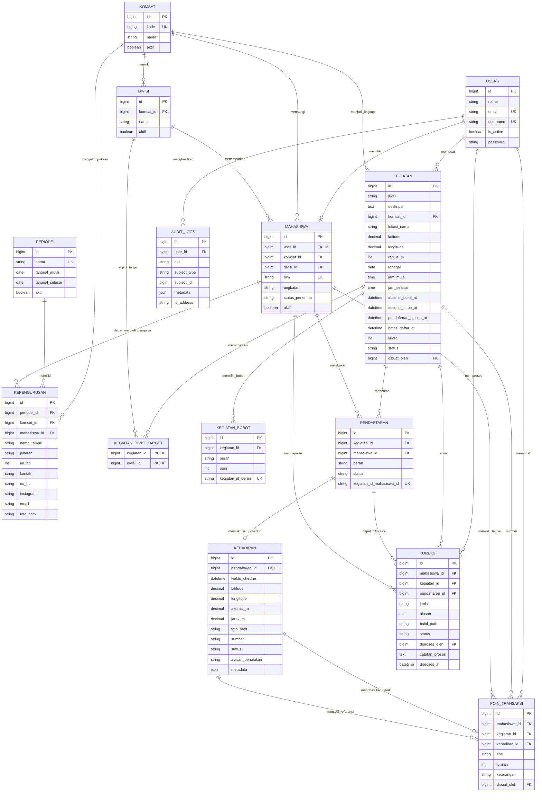

# ERD Aktual Sistem GenBI

Diagram berikut diringkas dari migration dan model aplikasi aktual, bukan dari
rencana lama. Tabel framework Laravel seperti `cache`, `jobs`, `sessions`,
`password_reset_tokens`, serta tabel permission Spatie tidak ditampilkan agar
diagram domain tetap terbaca.

## Constraint dan aturan penting

- `pendaftaran.kegiatan_id` + `pendaftaran.mahasiswa_id` unik: satu mahasiswa
  hanya memiliki satu pendaftaran per kegiatan.
- `divisi.komsat_id` + `divisi.nama` unik: nama divisi tidak boleh berulang
  pada Komsat yang sama.
- `kehadiran.pendaftaran_id` **unik**: satu pendaftaran hanya memiliki satu
  record check-in.
- `kegiatan_bobot.kegiatan_id` + `kegiatan_bobot.peran` unik; peran yang
  didukung adalah `peserta`, `panitia`, dan `pemateri`.
- `poin_transaksi` adalah ledger. Total poin mahasiswa dihitung dari
  `SUM(jumlah)`, bukan dari kolom total yang disimpan langsung.
- Tipe transaksi poin aktual adalah `kredit` dan `koreksi`; sumber koreksi
  dapat merujuk ke kehadiran dengan `sumber = koreksi`.
- Status kegiatan: `draft`, `terbit`, `berlangsung`, `selesai`, `terkunci`,
  `dibatalkan`.
- Status pendaftaran: `terdaftar`, `batal`.
- Status kehadiran: `valid`, `ditolak`, `menunggu_tinjau`.
- Status koreksi: `menunggu`, `disetujui`, `ditolak`.
